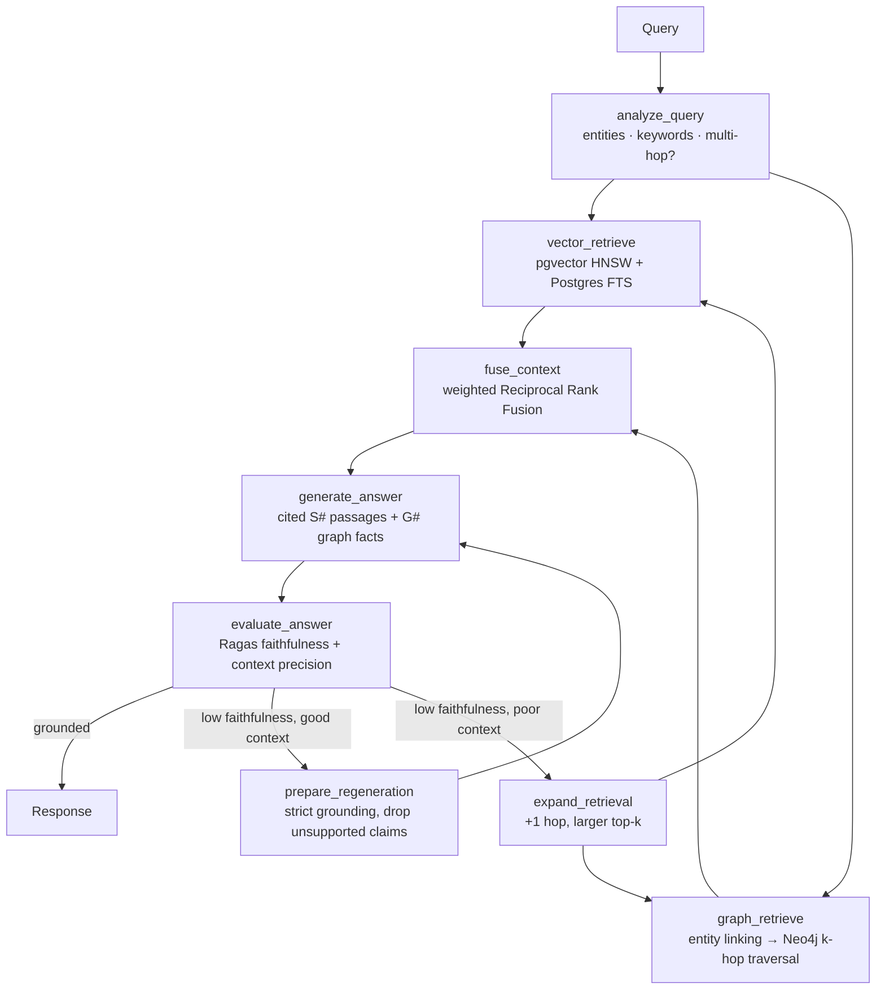

# Enterprise GraphRAG Engine


A production GraphRAG engine that **fuses pgvector semantic search with Neo4j knowledge-graph traversal** to answer multi-hop questions over enterprise documents, with **Ragas evaluation built into the request path** (faithfulness + context precision) and a self-correction loop that rewrites or re-retrieves when an answer isn't grounded.

It ships with a benchmark harness that measures GraphRAG against pure vector RAG on the same questions, so accuracy and hallucination claims come from reproducible runs.

---

## Why GraphRAG

Vector search finds passages that *look like* the question. Multi-hop questions need facts that don't look like the question at all:

> *"Who is the executive sponsor of the cloud vendor that hosts the platform behind the Customer 360 Dashboard?"*

The answer chains four facts in three documents: Dashboard → **depends on** Helios → **hosted by** Stratus Cloud → **sponsored by** Marcus Bell. Only the first passage resembles the question. The knowledge graph links entities across documents, and traversal pulls in the missing hops and the source passages behind them.

## Architecture



| Stage | What it does |
|---|---|
| **Ingestion** | Structure-aware chunking → OpenAI embeddings → LLM entity/relationship extraction (structured output) → entities merged across chunks and documents by canonical ID → written to Postgres *and* Neo4j, with every relationship keeping the chunk IDs it came from. |
| **Vector retrieval** | Dense cosine search (pgvector HNSW) plus full-text search (`tsvector`/GIN) for exact terms such as IDs and policy codes. |
| **Graph retrieval** | Query entities linked to graph nodes (exact name + entity-embedding similarity in pgvector), then a bounded variable-length traversal in Neo4j. Returns ranked facts and the source chunks that support them. |
| **Fusion** | Weighted RRF across dense, keyword and graph-sourced chunks. Multi-hop queries weight the graph higher. |
| **Generation** | Answers only from labelled context and cites `[S#]` passages and `[G#]` graph facts. |
| **Evaluation & self-correction** | Ragas scores every answer. Below `FAITHFULNESS_THRESHOLD` the graph either regenerates under strict grounding (listing the unsupported claims) or widens retrieval, up to `MAX_CORRECTION_ATTEMPTS`. |

If Ragas can't be imported or fails at runtime, a built-in LLM judge that follows the Ragas metric definitions takes over, so evaluation never silently turns off. The engine in use is shown at `/health`.

## Project layout

```
app/
  main.py               FastAPI app factory, lifespan, web console
  api/routes.py         REST endpoints
  graph.py              LangGraph workflow (fan-out / join / correction loop)
  nodes.py              node implementations + routing policy
  state.py              GraphRAGState
  services.py           dependency container
  config.py             environment settings
  llm.py                OpenAI chat / structured output / embeddings
  prompts.py            all prompts
  generation.py         grounded answer synthesis
  ingestion/            chunker, KG extractor, ingestion pipeline
  retrieval/            query analyzer, vector + graph retrievers, RRF fusion
  evaluation/           Ragas evaluator, LLM-judge fallback, benchmark harness
  stores/               PostgreSQL/pgvector and Neo4j (Bolt or HTTP) stores
  static/index.html     browser console
data/
  sample_corpus/        6 interlinked enterprise documents
  eval/multihop_eval.json   14 labelled questions (10 multi-hop, 4 single-hop)
scripts/                init_db.py, ingest.py, run_benchmark.py
tests/                  unit + end-to-end tests with in-memory fakes
```

## Getting started

**Prerequisites:** Python 3.10+, Docker, an OpenAI API key.

```bash
git clone https://github.com/valentinakiyungi/enterprise-graphrag-engine.git
cd enterprise-graphrag-engine
cp .env.example .env            # add OPENAI_API_KEY
pip install -r requirements.txt

make infra                      # PostgreSQL+pgvector and Neo4j via docker compose
make init                       # create tables, indexes and graph constraints
make ingest                     # load data/sample_corpus
make serve                      # http://127.0.0.1:8000
```

Or run the whole stack in containers: `make up`.

Open **http://127.0.0.1:8000** for the console (ask questions, ingest documents, run benchmarks) or **/docs** for Swagger UI. Neo4j Browser is at http://localhost:7474 if you want to look at the graph.

> **Neo4j transport.** `requirements.txt` doesn't include the `neo4j` driver, so the engine talks to Neo4j over its HTTP API using only the standard library. If you `pip install neo4j`, it switches to Bolt automatically (`NEO4J_TRANSPORT=auto`).

## API

| Method | Path | Purpose |
|---|---|---|
| `POST` | `/api/query` | Ask a question (`mode`: `hybrid` · `vector` · `graph`) |
| `POST` | `/api/documents` | Ingest one document |
| `POST` | `/api/documents/batch` | Ingest many (background job) |
| `GET` | `/api/jobs/{id}` | Batch job status |
| `GET` / `DELETE` | `/api/documents[/{id}]` | List / inspect / delete (cleans both stores) |
| `GET` | `/api/graph/entities/search?q=` | Semantic entity search |
| `GET` | `/api/graph/entities/{id}` | Entity neighbourhood |
| `POST` | `/api/evaluate` | Score any (question, answer, contexts) with Ragas |
| `POST` / `GET` | `/api/benchmarks[/{id}]` | Start / read vector-vs-GraphRAG benchmark runs |
| `GET` | `/api/stats`, `/health` | Operations |

```bash
curl -s localhost:8000/api/query -H 'Content-Type: application/json' -d '{
  "query": "Who is the executive sponsor of the cloud vendor that hosts the platform behind the Customer 360 Dashboard?",
  "mode": "hybrid", "include_trace": true }' | jq '{answer, evaluation, attempts}'
```

Set `API_KEY` in `.env` to require an `X-API-Key` header on every `/api` call.

## Measuring GraphRAG vs vector RAG

```bash
make benchmark                    # vector vs hybrid on data/eval/multihop_eval.json
python scripts/run_benchmark.py --modes vector hybrid graph --limit 5
```

Each question is answered in every mode and scored with Ragas faithfulness and context precision, plus answer accuracy against the reference answer. The report gives per-mode metrics and the deltas:

- `multi_hop_accuracy_improvement_pct` — hybrid vs vector accuracy on multi-hop questions
- `hallucination_reduction_pct` — relative drop in answers with faithfulness < `HALLUCINATION_THRESHOLD`

Reports are written to `reports/` and stored in the `eval_runs` table (the console shows them too). Use your own labelled questions to benchmark your own corpus: a JSON list of `{question, reference, type}`.

## Configuration

Every field in `app/config.py` can be set as an environment variable. The main ones:

| Variable | Default | Meaning |
|---|---|---|
| `OPENAI_CHAT_MODEL` / `OPENAI_EVAL_MODEL` | `gpt-4o-mini` | Generation / evaluation models |
| `OPENAI_EMBEDDING_MODEL`, `EMBEDDING_DIM` | `text-embedding-3-small`, 1536 | Must match the DB schema |
| `GRAPH_MAX_HOPS` | 2 | Traversal depth (1–4) |
| `VECTOR_TOP_K`, `FINAL_CONTEXT_CHUNKS` | 8, 8 | Retrieval breadth |
| `EVALUATE_ON_QUERY` | true | Run Ragas + self-correction on every query |
| `EVAL_ENGINE` | auto | `ragas`, `llm_judge`, or `auto` (Ragas with fallback) |
| `FAITHFULNESS_THRESHOLD` | 0.75 | Below this the answer is corrected |
| `MAX_CORRECTION_ATTEMPTS` | 2 | Retry budget |

## Tests

```bash
pip install pytest
make test
```

The suite uses in-memory fakes for OpenAI, Postgres and Neo4j, so it needs no services. It covers chunking, entity normalisation and merging, RRF, the Ragas-equivalent metric maths, benchmark aggregation, multi-hop traversal, document deletion across both stores, the self-correction loop, the full LangGraph workflow and the API.

## License

Distributed under the MIT License. See [LICENSE](LICENSE).
