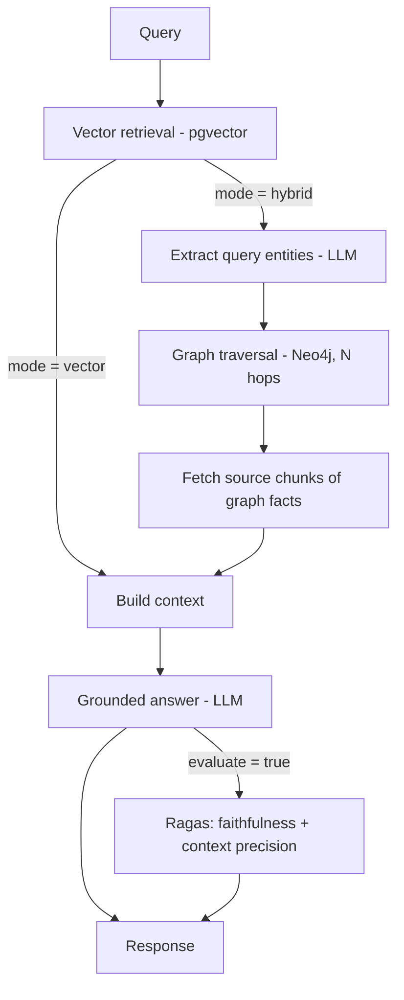

# Enterprise GraphRAG Engine


A **Graph Retrieval-Augmented Generation (GraphRAG)** service built with **LangGraph** and **FastAPI**. It combines semantic vector search (PostgreSQL + pgvector) with knowledge-graph traversal (Neo4j) to answer multi-hop questions that plain vector RAG misses, and scores every answer with **Ragas** (faithfulness, context precision).

## How it works



**Ingestion:** each document is chunked and embedded into Postgres; an LLM extracts `(subject, predicate, object)` triples from every chunk into Neo4j. Each graph edge remembers the chunk it came from.

**Querying:** vector search finds the closest chunks. In `hybrid` mode the question's entities are located in the graph, facts within `GRAPH_MAX_HOPS` are collected, and the source chunks of those facts (the "second hop" that vector similarity never surfaces) are added to the context. The answer prompt forbids outside knowledge and requires an explicit "I don't know" when the context is insufficient. `mode: "vector"` is the plain-RAG baseline used for comparison.

## Quick start (Docker Compose)

```bash
git clone https://github.com/valentinakiyungi/enterprise-graphrag-engine.git
cd enterprise-graphrag-engine
cp .env.example .env        # set OPENAI_API_KEY and both database passwords
docker compose up --build   # Postgres + Neo4j + API on http://localhost:8000
```

Interactive docs: http://localhost:8000/docs

```bash
# ingest
curl -X POST localhost:8000/ingest -H 'Content-Type: application/json' -d '{
  "documents": [
    {"doc_id": "projects", "text": "Tomas Weber leads Project Atlas."},
    {"doc_id": "people",   "text": "Tomas Weber reports to Elena Petrova."}
  ]}'

# query (add -H "X-API-Key: ..." if API_KEY is set)
curl -X POST localhost:8000/query -H 'Content-Type: application/json' -d '{
  "query": "Who is the manager of the person who leads Project Atlas?",
  "mode": "hybrid", "evaluate": true}'
```

## API

| Endpoint | Description |
|---|---|
| `POST /ingest` | Chunk, embed and graph-index documents (re-ingesting a `doc_id` replaces it) |
| `POST /query` | `{query, mode: hybrid\|vector, top_k?, evaluate?}` returns the answer, graph facts, sources, Ragas scores, `low_confidence` flag |
| `GET /health` | Liveness (no auth) |
| `GET /ready` | Readiness: checks Postgres and Neo4j |
| `GET /stats` | Chunk, entity and relationship counts |

If `API_KEY` is set, all endpoints except `/health` and `/ready` require an `X-API-Key` header. Configuration lives in `.env.example`.

## Benchmarking vector RAG vs GraphRAG

`benchmark/` contains a small fictional corpus and 12 questions (9 multi-hop, 3 unanswerable).

```bash
docker compose up -d
docker compose run --rm api python -m benchmark.run
```

It runs every question in both modes and reports answer accuracy (LLM judge; for unanswerable questions, correct = declined), Ragas faithfulness and context precision, and hallucination rate (answered, not declined, faithfulness below `FAITHFULNESS_THRESHOLD`), plus relative change of hybrid vs vector. The table is printed, and `results.json` / `results.md` are written to `benchmark/results/` (inside the container when run via compose).

The sample set is small, so treat its numbers as a smoke test, not a result. For figures you can cite, replace `benchmark/corpus` and `benchmark/questions.jsonl` with your own documents and a larger question set, and quote the numbers your run produces.

## Development

```bash
pip install -r requirements-dev.txt
python -m pytest        # no databases or API key needed: tests use in-memory fakes
uvicorn app.main:app --reload   # needs running Postgres + Neo4j (docker compose up postgres neo4j)
```

## Deployment

See [DEPLOY.md](DEPLOY.md).

## License

MIT
